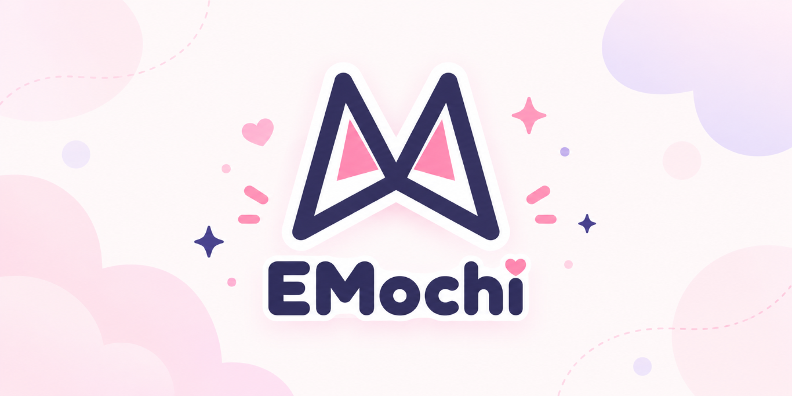

# EMochi

<p align="center"></p>

EMochi（Emote ＋ Mochi）是給實況主、創作者用的 **AI 貼圖生成工具**：給它你的角色圖和想要的畫風，它會用 Codex CLI 的 `$imagegen` 一次生成一整組表情貼圖，自動切割、去背，再依平台規格輸出各種尺寸。

- **一次生一組**：每張網格圖 8 個表情（4×2），32 種基礎表情 4 組就完成；表情清單可以自己新增、修改、分組
- **先預覽再量產**：先生一張 2×2 風格預覽，滿意了才批次生成；不滿意的組可以單獨重生
- **角色庫、畫風庫**：存好角色參考圖和畫風，下次直接選；Codex 能看圖幫你寫角色特徵、分析畫風
- **一鍵匯出各平台尺寸**：內建 Twitch、Discord、LINE、YouTube、Kick、Telegram、Slack 等 13 組規格，檔案太大會自動壓縮；也可以自訂
- **圖庫**：跨畫風並排比較、挑選、打包成 zip

> 目前只支援 **Windows**。

## 安裝

### 1. 準備 Codex CLI

EMochi 用 [Codex CLI](https://github.com/openai/codex) 生圖，**生圖用的是你自己 ChatGPT 帳號的 Codex 額度**（Plus、Pro、Business、Edu、Enterprise 等方案），所以要先裝好並登入：

1. 開 PowerShell，執行官方安裝指令（不需要 Node.js）：
   ```powershell
   powershell -ExecutionPolicy ByPass -c "irm https://chatgpt.com/codex/install.ps1 | iex"
   ```
   已經有 [Node.js](https://nodejs.org/) 的話，也可以改用 `npm install -g @openai/codex`。
2. 登入：執行 `codex login`，在跳出的瀏覽器選 **Sign in with ChatGPT**。

裝好後打 `codex --version` 有顯示版本就沒問題。EMochi 啟動時也會檢查，找不到 Codex 或還沒登入會跳出說明視窗，可以直接在視窗裡登入；沙盒設定（`--enable prefer_mxc`）EMochi 會自動帶，不用另外設定。

### 2. 安裝 EMochi

1. 到 [Releases](https://github.com/ShiroOYuki/EMochi/releases) 下載最新的 `EMochi Setup <版本>.exe`
2. 執行安裝檔。安裝檔目前**沒有程式碼簽章**，Windows 可能跳出「Windows 已保護您的電腦」：按「**其他資訊**」→「**仍要執行**」
3. 裝好後從開始選單開啟 EMochi

右上角的 Codex 狀態顯示已連線、已登入，就可以開始用了。

## 怎麼用

上方有幾個分頁：

- **生成**：做一套新貼圖
  1. 選角色（角色庫）和畫風（畫風庫，或臨時上傳參考圖），用中文描述想要的感覺，Codex 會擴寫成生圖用的描述（可以修改）
  2. 生成一張 2×2 **風格預覽圖**
  3. 滿意就勾選要生成的表情、選版型，開始批次生成（預覽圖會當作每一組的畫風範本）
  4. 逐組審核，不滿意的按「重生」；全部確認後自動切割、去背、輸出各尺寸
- **表情**：管理表情清單（新增、編輯、刪除、拖進分組）
- **畫風**：畫風庫，可以從參考圖分析畫風，也能從完成的作品匯入
- **角色**：角色庫，放參考圖和角色特徵
- **圖庫**：比較、勾選完成的貼圖，選匯出預設集打包成 zip

刪除的作品、畫風、角色會先進垃圾桶（側欄左下角），可以還原。
右上角會顯示 Codex 額度（5 小時、每週），點一下看詳細狀態。

### 小提醒

- 每張網格圖大約用掉 35K tokens 的 Codex 額度，一套 32 張（4 組）加上預覽與擴寫，請留意額度
- 有畫風參考圖時，建議只勾 1 張角色圖：生圖模型會從精細的角色立繪「順便」學畫法，蓋過你要的畫風
- 角色身上有大面積綠色時，去背可能吃掉角色，可以改用洋紅背景（見 [開發說明](docs/DEVELOPMENT.md#實作備忘)）

## 資料與更新

- 所有資料（設定、作品、角色庫、畫風庫、記錄檔）預設在 `%LOCALAPPDATA%\EMochi`，可以在設定頁（右上角齒輪）改到其他地方
- **解除安裝不會刪除資料**；要完全移除，解除安裝後再手動刪掉資料夾
- 有新版時右上角會出現「可更新」，按了才下載，下載好再按「重新啟動並安裝」；不按就不會更新

## 遇到問題

1. 先確認右上角 Codex 狀態：顯示找不到或未登入時，回到[安裝第 1 步](#1-準備-codex-cli)檢查
2. 到 App 的「**設定 → 說明 → 回報問題**」：
   - **在 GitHub 回報**：開啟 [GitHub Issues](https://github.com/ShiroOYuki/EMochi/issues/new/choose) 的回報表單，版本、系統、Codex 欄位會自動填好（需要 GitHub 帳號）
   - **用 Email 回報**：用預設郵件程式開新信寄到 cielwork518@gmail.com，信裡已附上診斷資訊
   - 兩種方式都會先把診斷資訊（版本、系統、Codex 狀態、設定摘要、最近失敗的 Codex 呼叫）複製到剪貼簿，路徑裡的使用者名稱會換成 `~`
3. 需要附 log 的話，同一區可以開啟 log 資料夾：Codex 的呼叫紀錄在 EMochi 資料夾（預設 `%LOCALAPPDATA%\EMochi`）的 `logs\`，桌面程式本身的 log 在 `%APPDATA%\EMochi\logs\`（`server.log` 是後端、`updater.log` 是更新）。log 裡可能有你的電腦路徑，附上前可以先看一下。EMochi 不會自動上傳任何檔案

## 支持開發

EMochi 免費、開源，所有功能都可以直接使用。如果它對你有幫助，歡迎請我喝杯咖啡：[綠界](https://p.ecpay.com.tw/C487EF9)（台灣，新台幣付款）或 [Ko-fi](https://ko-fi.com/ciel518)（國際：信用卡、PayPal）。App 右上角的愛心、或「設定 → 說明 → 支持開發」也能找到贊助連結。

## 從原始碼執行、開發

見 [docs/DEVELOPMENT.md](docs/DEVELOPMENT.md)：網頁版、修改前端、測試、打包、發版流程、資料夾結構。

## 免責聲明

- **非官方工具**：EMochi 是個人開發的開源工具，與 OpenAI、Twitch、Discord、LINE、YouTube、Kick、Telegram、Slack 等公司或平台沒有隸屬、合作或背書關係；提到的名稱與商標屬於各自的擁有者。
- **生成內容由你負責**：貼圖由 OpenAI Codex 依你提供的角色圖、畫風和描述生成。請自行確認上傳的參考圖與生成結果有權使用（著作權、肖像權等），並符合各平台的貼圖規範與 OpenAI 的使用條款；使用、上架或散布生成內容所產生的爭議，由使用者自行負責。
- **內建範例圖只供示範**：內建表情 #1～32 的範例圖、範例畫風的角色圖只用來示範與分析表情、畫風，著作權屬於作者。請勿把這些圖片本身當成你的貼圖上架、販售或另作他用（詳見 [ASSETS-LICENSE.md](ASSETS-LICENSE.md)）。
- **按現狀提供**：本軟體按「現狀」提供，不附任何明示或默示的擔保。生圖會消耗你的 ChatGPT／Codex 額度；作者不對額度消耗、生成結果、資料遺失或其他因使用本軟體造成的損失負責。

第一次開 App 時會顯示這份聲明，之後可以在「設定 → 關於 → 免責聲明」再看一次。

## 授權

- 程式碼：[GNU General Public License v3.0 或更新版本](LICENSE)。可以自由使用、修改、散布（含商用），但散布修改版時必須同樣以 GPL 開放原始碼。
- 內建範例畫風 `st1` 的角色圖、內建表情 #1～32 的範例圖等素材**不在 GPL 範圍內**，保留一切權利，詳見 [ASSETS-LICENSE.md](ASSETS-LICENSE.md)。
